<div align="center">

# 🔨 Wireshark SOC Lab: Catching an FTP Brute-Force Attack

**Finding who was guessing passwords against an FTP server, and whether the attacker got in**
</div>

<p align="center">
  
  
  
  
  
</p>

---

## 📌 Project Overview

This is Lab 7 of the Networkwalks Wireshark SOC labs. The scenario:

> *You are a SOC analyst. The FTP server owner reports many failed sign-ins in the last minutes. Capture the traffic, find who is guessing passwords and whether the attacker got in.*

The lab runs in the browser. It gives you a Windows 11 PC with Wireshark installed, and you complete **10 tasks** (10 marks each) by capturing traffic, finding the failed and successful logins, and naming the attack. I followed the lab's written instructions for each task. My final score was **99/100**: every answer was correct, and one hint on Task 2 cost 1 mark.

All the IP addresses, usernames and passwords in this lab are simulated lab data.

| 🔎 Item          | ✅ Result                                                   |
| ---------------- | ----------------------------------------------------------- |
| Attacker         | `192.168.10.66`                                             |
| Target           | FTP server `192.168.10.20`                                  |
| Failed logins    | 24 (reply code `530`)                                       |
| What worked      | `admin` / `Sunshine99` (reply code `230`)                   |
| Attack type      | **Brute force**                                             |

---

## 🎯 Objectives

- Capture traffic in Wireshark and read the total packet count.
- Use **Statistics → Protocol Hierarchy** to find which protocol the failed sign-ins were on.
- Use display filters to find the FTP server, the attacker, and the username being tried.
- Count the failed logins and find the one that worked.
- Use **Follow → TCP Stream** to read the password that got in.
- Name the attack type from the pattern.

---

## 🛡️ Why This Matters for Security

A brute-force attack is a very common way to break into a service: the attacker keeps guessing passwords until one works. In a capture it shows up as a long run of failed logins from one address, followed (in the worst case) by a success.

For a SOC analyst, the key questions are the ones this lab asks: who is guessing, which account are they targeting, how many times did they fail, and **did they get in**. Answering the last one decides whether this is an alert or an incident.

> ⚠️ **Important:** Only capture and read network traffic on networks and devices you own or have explicit permission to monitor, and never guess passwords on systems you don't have permission to test. This lab runs in a simulated environment provided by Networkwalks.

---

## ⚙️ Lab Configuration

| 🧩 Component        | ⚙️ Configuration                                                               |
| ------------------- | ------------------------------------------------------------------------------ |
| 🌐 Platform         | Networkwalks online lab (`networkwalks.com/wireshark-lab7`)                    |
| 🖥️ Analyst PC       | Windows 11 PC in the lab (user `Student`)                                      |
| 🦈 Tool             | Wireshark, capturing on the `WiFi` interface                                   |
| 📦 Capture Size     | 369 packets                                                                    |
| 🧭 Capture Point    | Switch with a SPAN port mirroring traffic to the analyst PC                    |
| 🧑‍💻 SOC Analyst      | `192.168.10.10`                                                                |
| 🗄️ FTP Server       | `192.168.10.20`                                                                |
| 🏆 Scoring          | 10 tasks × 10 marks; each hint costs 10% of that task's marks                  |

### Topology (from the lab brief)

```text
SOC Analyst (Wireshark)          Unknown PC (IP unknown at the start)
 192.168.10.10                              │
        │                                   │
        └──────────── Switch ───────────────┘
                  (SPAN: packet capture point)
                          │
                Other hosts, FTP Server 192.168.10.20
```

---

# 🪜 Lab Procedure

## Step 1. Capture the Traffic (Task 1)

I signed in to the Windows PC, opened Wireshark, and double-clicked the `WiFi` interface to start the capture. The status bar shows **Packets: 369**.

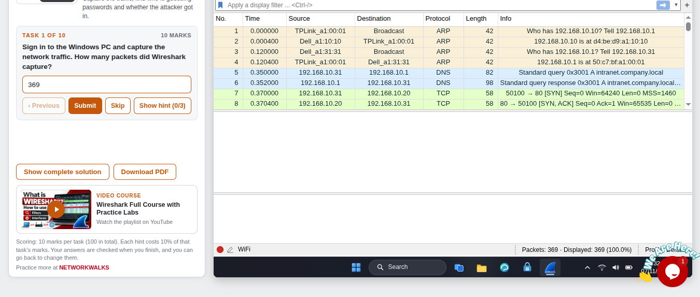

**Answer: 369.**

---

## Step 2. Find the Protocol (Task 2)

I opened **Statistics → Protocol Hierarchy** to see which protocols are in the capture. Under TCP, one stands out: **File Transfer Protocol (FTP)**, with 117 packets (31.7% of the capture). FTP is an old file transfer protocol that logs in with the commands `USER` and `PASS`.

| Protocol           | Packets | Percent of packets |
| ------------------ | ------- | ------------------ |
| TCP                | 317     | 85.9%              |
| FTP                | 117     | 31.7%              |
| DNS                | 42      | 11.4%              |
| HTTP               | 20      | 5.4%               |
| TLS                | 10      | 2.7%               |
| ICMP               | 6       | 1.6%               |
| ARP                | 4       | 1.1%               |

I opened Hint 1 on this task, which costs 10% of its marks (see *Challenges Encountered*).

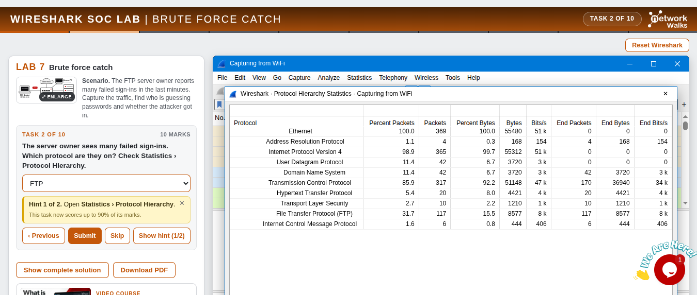

**Answer: FTP.**

---

## Step 3. Find the Target (Task 3)

I filtered on the protocol:

```text
ftp
```

The server sends the replies, such as `220 FTP server ready` and `530 Login incorrect`, so the **Source** of those packets is the server: **`192.168.10.20`**. In packet 58, the server (port 21) sends `530 Login incorrect` to `192.168.10.66`.

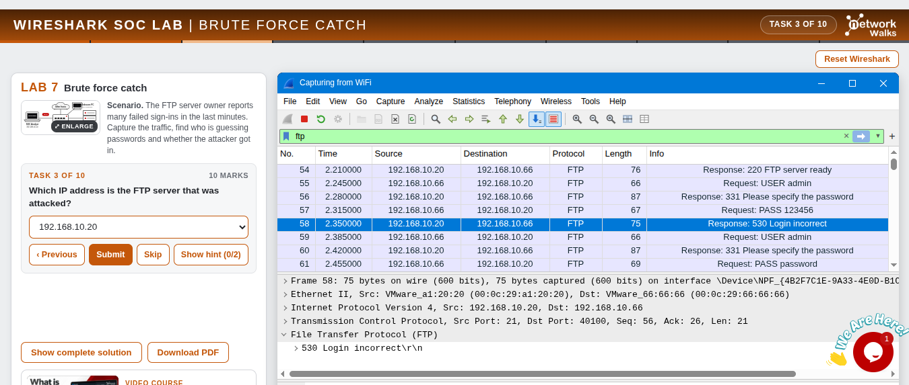

**Answer: `192.168.10.20`.**

---

## Step 4. Find the Attacker (Task 4)

The attacker is the address that sends the login attempts. With the same capture, the FTP packets going to the server (`Request: USER admin`, `Request: PASS ...`) all come from **`192.168.10.66`**.

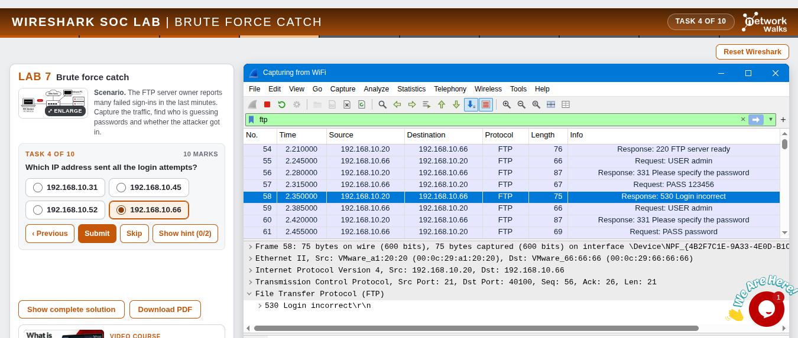

**Answer: `192.168.10.66`.** The server answers; the attacker asks.

---

## Step 5. Find the Username (Task 5)

```text
ftp.request.command == "USER"
```

Every line says `Request: USER admin`. The attacker kept the **same username** and changed only the password.

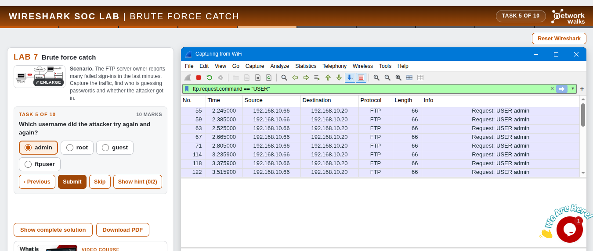

**Answer: `admin`.**

---

## Step 6. Find the Failure Code (Task 6)

```text
ftp.response.code >= 500
```

The Info column shows `Response: 530 Login incorrect`, so the failure code is **530**.

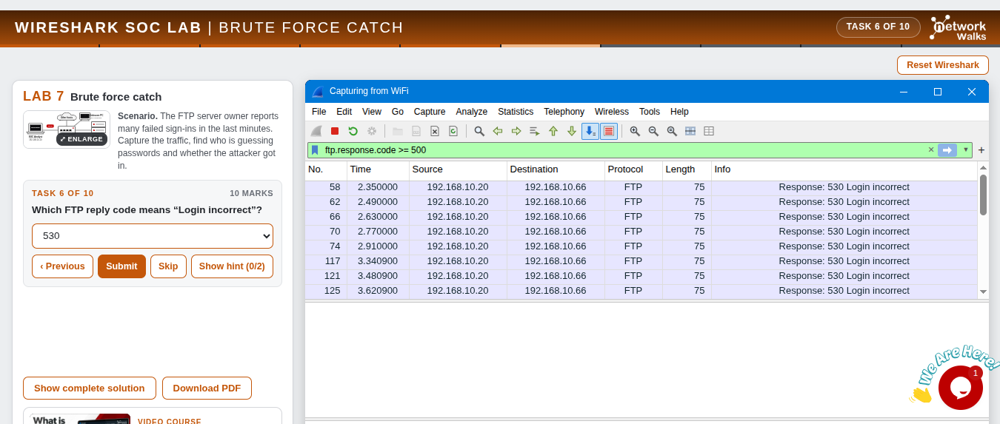

**Answer: 530.**

---

## Step 7. Count the Failed Logins (Task 7)

```text
ftp.response.code == 530
```

The status bar shows **Displayed: 24 (6.5%)** of the 369 packets: 24 failed logins.

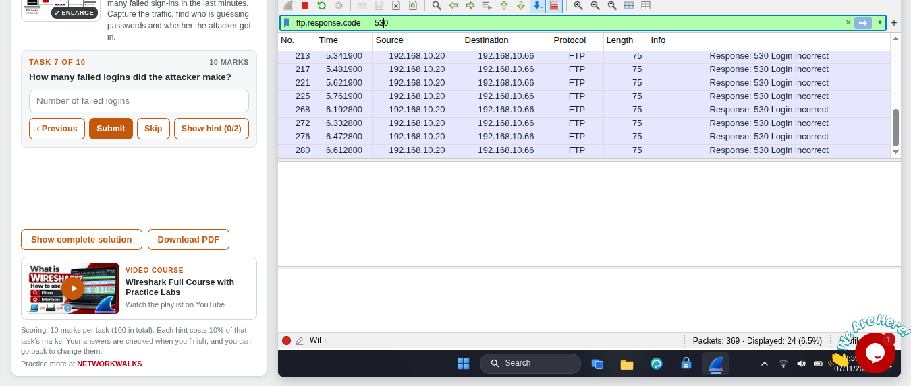

**Answer: 24.**

---

## Step 8. Find the Success Code (Task 8)

```text
ftp.response.code == 230
```

Only one packet stays in the list: packet 284 at 6.75 s, `Response: 230 Login successful`, from the server to the attacker. **The attacker got in.**

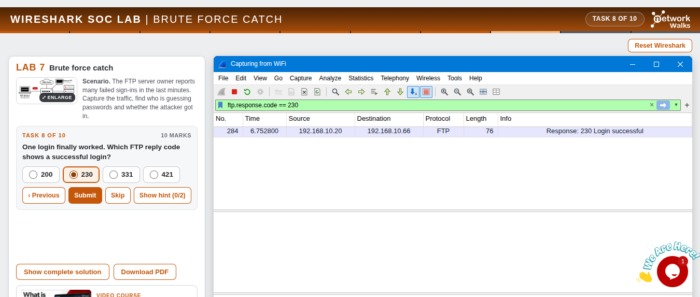

**Answer: 230.**

---

## Step 9. Find the Password That Worked (Task 9)

I right-clicked the `230` packet and chose **Follow → TCP Stream** (stream 13). The window shows the attacker's commands in red and the server's replies in blue. The last part of the session reads:

```text
USER admin
331 Please specify the password
PASS Winter2025
530 Login incorrect
USER admin
331 Please specify the password
PASS Company1
530 Login incorrect
USER admin
331 Please specify the password
PASS Admin@123
530 Login incorrect
USER admin
331 Please specify the password
PASS Sunshine99
230 Login successful
PWD
257 "/" is the current directory
QUIT
221 Goodbye
```

The bottom bar shows **12 client packets, 13 server packets, 25 turns, Entire conversation (493 bytes)**.

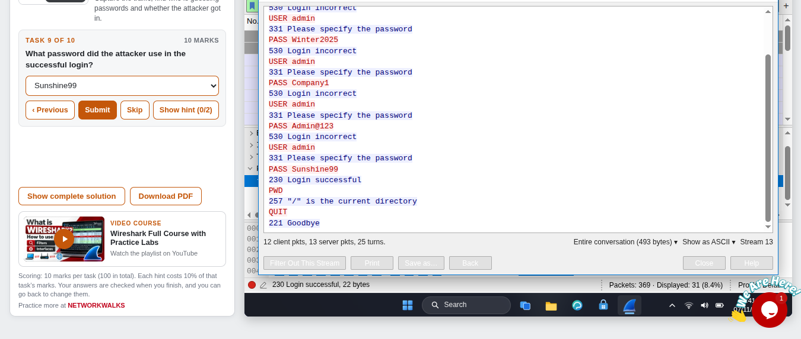

**Answer: `Sunshine99`.**

---

## Step 10. Name the Attack (Task 10)

Many password guesses for one user, then one success, is a **brute-force attack**. It is not a port scan (which probes many ports) and not DNS spoofing or phishing (which don't involve repeated guesses at one login).

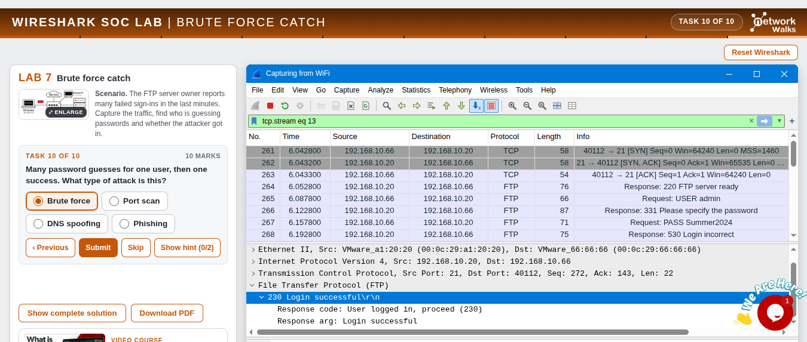

**Answer: Brute force.**

---

## Step 11. Result

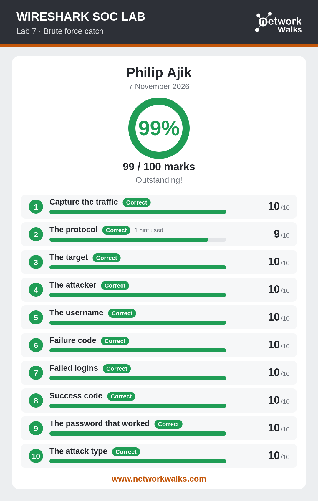

---

# 📊 Results

| #  | 🎯 Task               | ✅ Answer                  | 🔎 How I Found It                                          | 🏆 Result |
| -- | --------------------- | -------------------------- | ---------------------------------------------------------- | --------- |
| 1  | Capture the traffic   | `369` packets              | Status bar after starting the capture                      | ✅ 10/10  |
| 2  | The protocol          | `FTP`                      | Statistics → Protocol Hierarchy                            | ✅ 9/10 (1 hint used) |
| 3  | The target            | `192.168.10.20`            | Source of the `Response: 530` packets                      | ✅ 10/10  |
| 4  | The attacker          | `192.168.10.66`            | Source of the `USER` and `PASS` requests                   | ✅ 10/10  |
| 5  | The username          | `admin`                    | `ftp.request.command == "USER"`                            | ✅ 10/10  |
| 6  | Failure code          | `530`                      | `ftp.response.code >= 500`                                 | ✅ 10/10  |
| 7  | Failed logins         | `24`                       | `ftp.response.code == 530`, Displayed in the status bar\*  | ✅ 10/10  |
| 8  | Success code          | `230`                      | `ftp.response.code == 230`                                 | ✅ 10/10  |
| 9  | The password that worked | `Sunshine99`            | Follow → TCP Stream on the `230` packet                    | ✅ 10/10  |
| 10 | The attack type       | `Brute force`              | Many guesses for one user, then one success                | ✅ 10/10  |

\* My Task 7 screenshot shows the filter and `Displayed: 24`, but the answer box on that screen is still empty. The 24 matches the lab's answer key, and my result card marks Task 7 correct.

### Timeline (from the packets)

| ⏱️ Time (s) | 📦 Packet | 🔄 What happened                                                         |
| ----------- | --------- | ------------------------------------------------------------------------ |
| 2.210       | 54        | Server tells `192.168.10.66`: `220 FTP server ready`                     |
| 2.245       | 55        | Attacker sends `USER admin`                                              |
| 2.315       | 57        | Attacker sends `PASS 123456`                                             |
| 2.350       | 58        | Server replies `530 Login incorrect`                                     |
| 2.385       | 59        | Attacker sends `USER admin` again                                        |
| 2.455       | 61        | Attacker sends `PASS password`                                           |
| 6.043       | 261       | Last connection opens (stream 13)                                        |
| 6.158       | 267       | Attacker sends `PASS Summer2024`, which fails                            |
| 6.753       | 284       | Server replies `230 Login successful` after `PASS Sunshine99`            |

---

# 🔭 Observations Beyond the Task Questions

These are things I saw in the screenshots while documenting. The lab does not ask for them.

1. **The guesses are very regular.** The `530` replies in the first block arrive at 2.350, 2.490, 2.630, 2.770 and 2.910 s, exactly 140 ms apart, and the last four failures before the success (6.193, 6.333, 6.473 and 6.613 s) are spaced the same way. A person typing would not be this even, which points to a script.
2. **The passwords look like a word list.** The ones visible in my screenshots (`123456`, `password`, `Summer2024`, `Winter2025`, `Company1`, `Admin@123`) are common or guessable patterns, such as simple numbers, seasons with a year, or the company name with a digit.
3. **One account, many passwords.** The username stayed `admin` every time. That is what separates a brute-force attack from password spraying, where one password is tried against many accounts.
4. **Every attempt is readable.** FTP sends `USER` and `PASS` in plain text, so the capture shows each guess, including the one that worked.
5. **The attacker did very little after getting in.** In the stream I can see only `PWD` (which returned `/`) and `QUIT`. What they did afterwards, or in other sessions, is not in my screenshots.
6. **No lockout is visible in the capture.** The server kept answering `331 Please specify the password` through 24 failures. I can't tell from the packets whether a lockout or rate limit exists on the server, only that none stopped this attacker.
7. **The attacker was a small part of the capture.** The failed logins are 24 of the 369 packets (6.5%), and the FTP conversation 117 packets (31.7%). Protocol Hierarchy made it easy to find.

---

# 🐞 Challenges Encountered

I had no technical difficulties, and every answer I submitted was correct. The one place I lost marks was **Task 2**.

* **Issue:** I opened Hint 1 on Task 2 ("Open Statistics › Protocol Hierarchy"), which the lab charges 10% of the task for. My result card shows "1 hint used" and 9/10 for that task.
* **Result:** 99/100 instead of 100/100.
* **What I'll do differently:** the task itself already pointed to Protocol Hierarchy, and the lab's second hint says to look for "the protocol with login commands (`USER` and `PASS`)". Next time I'll open the menu first and read the list before asking for a hint. FTP is the one that logs in with `USER` and `PASS`.

---

# 💡 Key Learnings

1. **Protocol Hierarchy is a quick way to see what is in a capture:** FTP stood out among DNS, HTTP, TLS and ICMP.
2. **Servers answer, clients ask:** the Source of a `Response` packet is the server, and the Source of a `USER` or `PASS` request is the attacker.
3. **FTP reply codes tell the story:** `331` asks for a password, `530` means login incorrect, and `230` means login successful.
4. **Count the failures, then look for the success:** 24 failures alone is an alert. One `230` after them means the attacker is in.
5. **Follow TCP Stream shows the whole login session:** the guesses, the replies and what the attacker did next, in order.
6. **Brute force looks different from a port scan:** brute force is many guesses at one login, while a port scan probes many ports (as in Lab 3).
7. **Timing is evidence:** perfectly even gaps between attempts show automation.
8. **Plain-text FTP exposes the guesses and the working password:** encrypted alternatives (SFTP or FTPS), strong passwords and a lockout or rate limit on repeated failures make this much harder.
9. **Document the small losses too:** a single hint cost one mark, which is a good reminder to try first.

---

# 🔐 Security & Ethical Use

This lab is for education only and ran in a simulated environment provided by Networkwalks. The addresses, usernames and passwords in this document are lab data. Never attempt to guess passwords on systems you do not own or have permission to test, and only capture network traffic where you are authorized to.

---

# 🔗 Tools & Resources

- **Online lab:** [https://networkwalks.com/wireshark-lab7/](https://networkwalks.com/wireshark-lab7/)
- **Wireshark:** [https://www.wireshark.org/download.html](https://www.wireshark.org/download.html)
- **NetworkWalks:** [https://networkwalks.com](https://networkwalks.com)

---

# 👤 Author

**Philip Ajik**  
Cybersecurity Student (Batch B082) — Networkwalks Academy  
LinkedIn: [https://www.linkedin.com/in/philip-ajik-a22944384](https://www.linkedin.com/in/philip-ajik-a22944384)

---

## 📌 Project Information

**Program Name:** Cybersecurity at Networkwalks | **Task:** Wireshark SOC Lab 7 | **Project:** Brute Force Catch | **Repository:** GitHub
